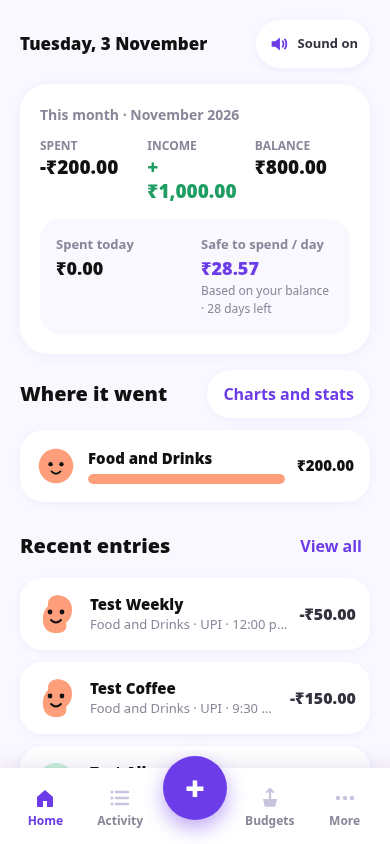

# Expense Log — Manual budgeting, built for India

Expense Log is a manual expense and budget tracker prototype built for Indian numbering and paise-accurate entries, with a large number pad made for fast logging.

## What it does

- Cash, UPI, bank, and card balances, pastel expense categories, and income, all starting at zero with nothing prefilled.
- Overall and per-category budgets with clear warnings before and after a limit is crossed.
- Recurring entries and savings goals with a dated contribution log.
- Spending charts, search and filters, and CSV export plus JSON backup and restore.

## Status

Working prototype, built November 2026. Manual logging only: no bank, UPI, or account sync, and it says so.

## Showcase only

This repository is a showcase. It contains no source code and no build files, and nothing here is open source. The screenshot(s) above are showcase images only. See NOTICE.md.

## Contact

Built by Yash Dashrath, Pune, India.

- Email: yashdashrath18@gmail.com
- LinkedIn: https://www.linkedin.com/in/yash-dashrath
- Yash MediaWorks: https://www.linkedin.com/company/yashmediaworks/
